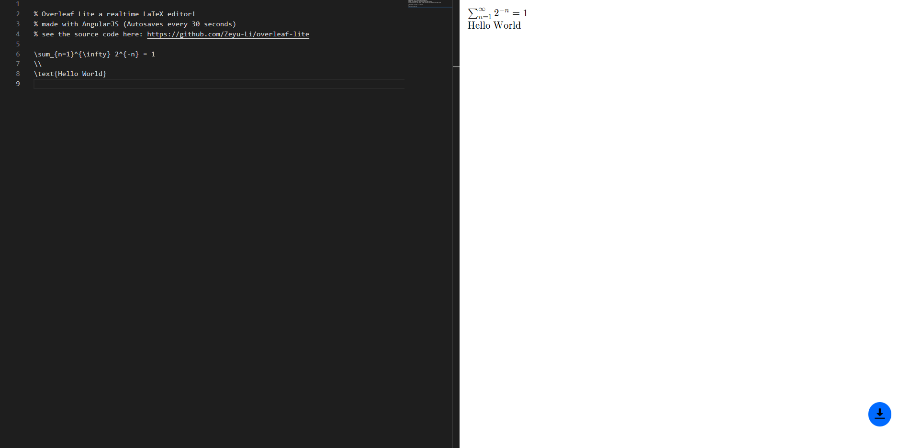

# Overleaf Lite

 

A light-weight clone of [Overleaf](https://www.overleaf.com/)

Has autosave on keypress and realtime rendering in LaTeX

## Screenshot

Made with Angular (originally generated with [Angular CLI](https://github.com/angular/angular-cli) version 9.1.13, now on Angular 22). Requires Node.js 24 and Yarn 1.

## Development server

Run `yarn install`, then `yarn start` for a dev server. Navigate to `http://localhost:4200/`. The app will automatically reload if you change any of the source files.

## Code scaffolding

Run `ng generate component component-name` to generate a new component. You can also use `ng generate directive|pipe|service|class|guard|interface|enum|module`.

## Build

Run `yarn build` to make a production build. The build artifacts will be stored in the `dist/overleaf-lite/` directory.

## Running unit tests

Run `yarn test` to execute the unit tests via [Vitest](https://vitest.dev).

## Further help

To get more help on the Angular CLI use `ng help` or go check out the [Angular CLI README](https://github.com/angular/angular-cli/blob/master/README.md).

## Dependencies

* SCSS
* KaTeX
* @ngstack/code-editor (with a self-hosted, version-pinned Monaco editor)

## License

 

